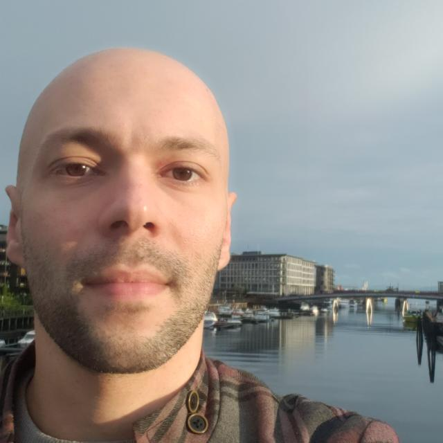

.. LBPM-Documentation documentation master file.

Ricardo Leite Martins Bazarin: Academic Documentation (05/September/2025 - |today|)
===================================================================================

Mechanical Engineer, graduated from the Federal Technological University of Paraná (UTFPR), Guarapuava campus. He holds both 
a master's degree and a doctorate in the Thermal Sciences area from the Graduate Program in Mechanical and Materials Engineering 
at UTFPR, Curitiba campus. He has participated in research groups on Porous Media and Rheology, where he developed work in 
numerical modeling applied to Thermal Sciences and Fluid Mechanics, with emphasis on the use and development of the Lattice 
Boltzmann Method. Currently, he is a researcher at the Federal University of Santa Catarina (UFSC), specializing in digital 
rock simulation using the Lattice Boltzmann Method on High-Performance Computing (HPC) systems.

- `Curriculum Lattes (Brazilian Academic Curriculum) <https://buscatextual.cnpq.br/buscatextual/visualizacv.do?id=K8733837Z4>`_

- `GitHub Page <https://github.com/Ricardoleite>`_

- `Google Scholar <https://scholar.google.com.br/citations?user=ybe2TbQAAAAJ&hl=pt-BR>`_

.. bibliography::
   :cited:
